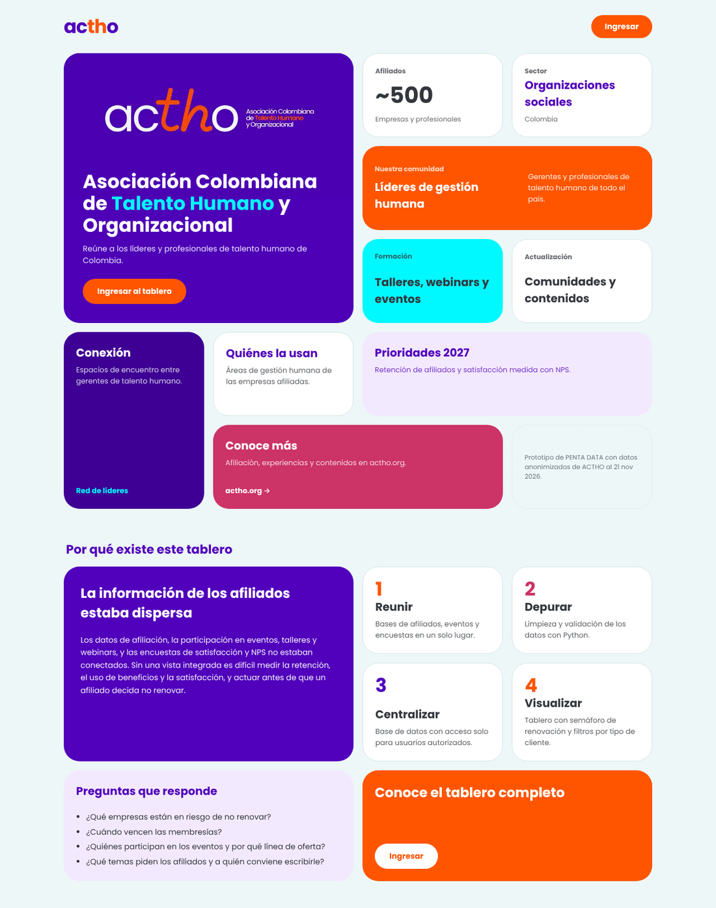
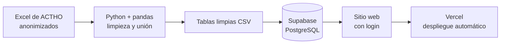
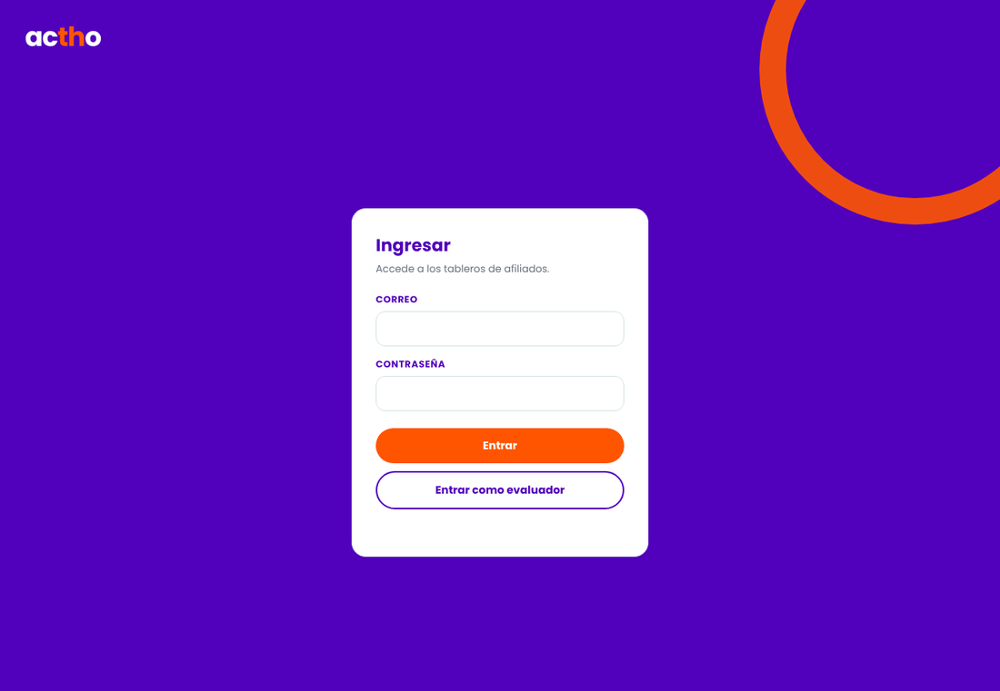
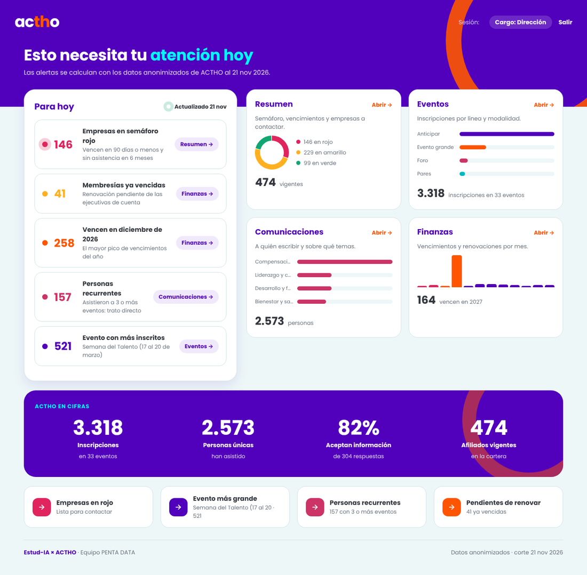
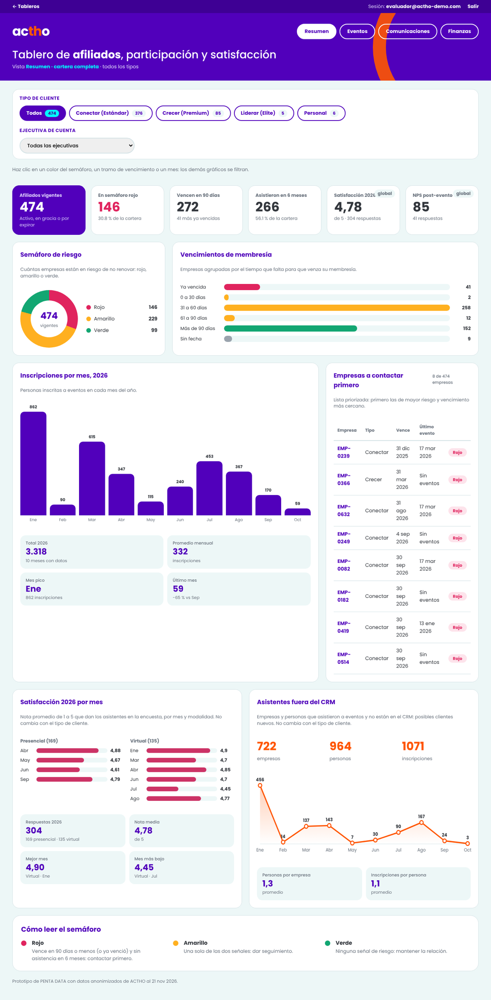
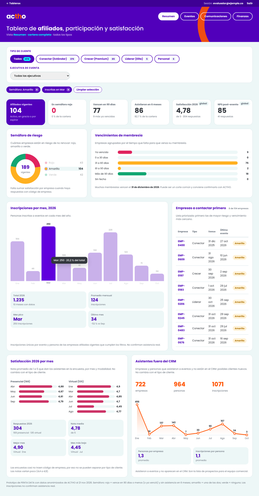
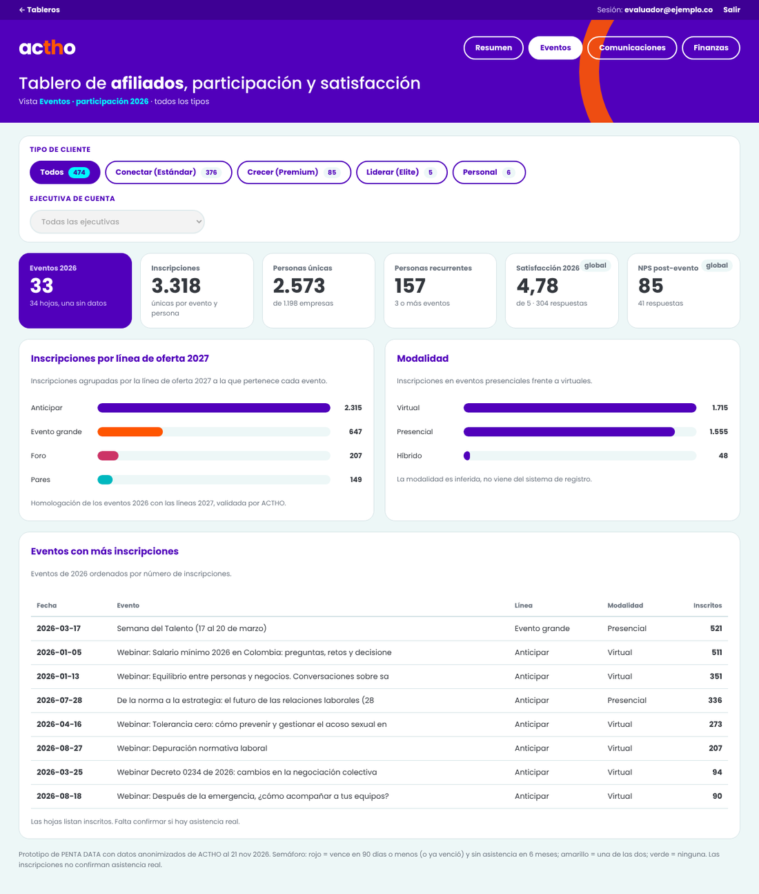
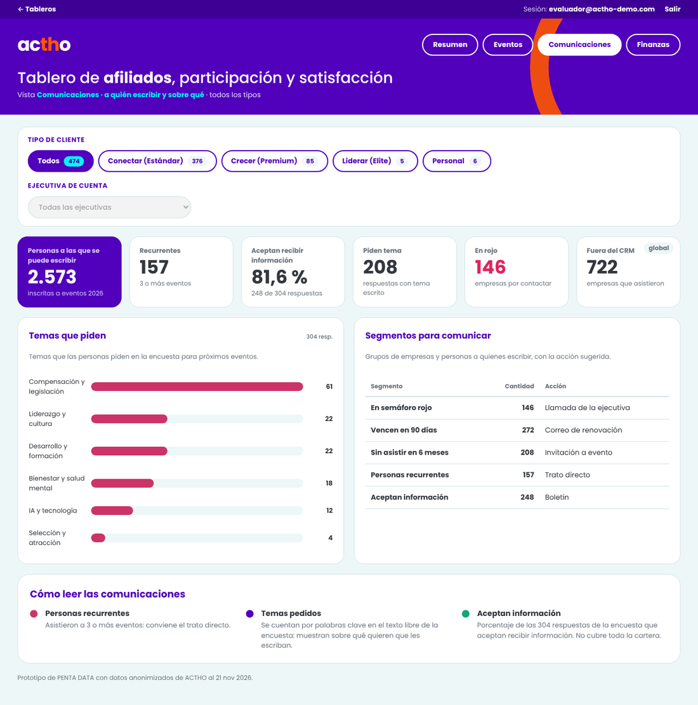
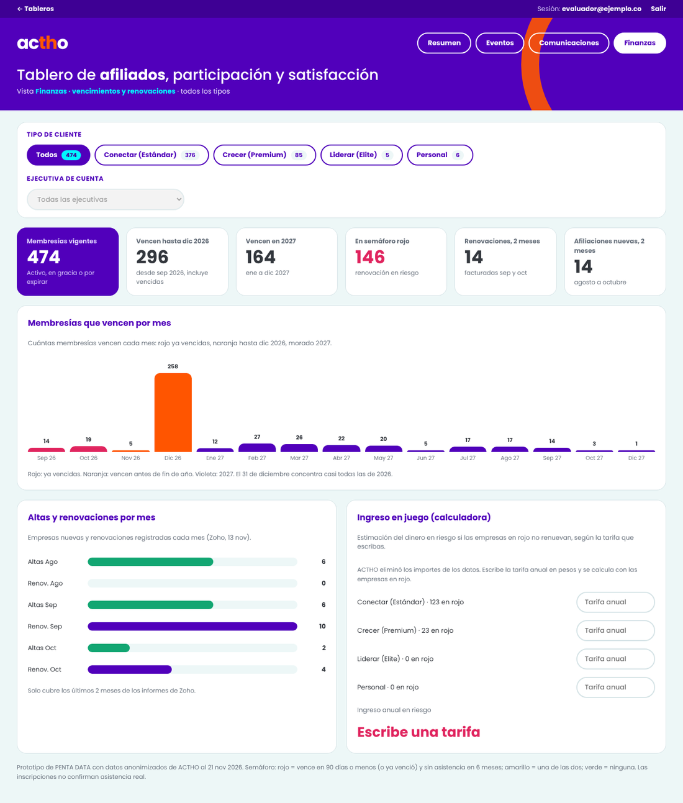

# EstudIA × ACTHO · Tablero integral de afiliados

Proyecto del equipo **PENTA DATA** para el reto empresarial de **ACTHO** (Asociación Colombiana de Talento Humano y Organizacional), dentro del programa EstudIA · Análisis de datos · Capa 2.

> **Trabajo de análisis de datos en equipo.** Este proyecto fue desarrollado en conjunto por varios colaboradores del equipo PENTA DATA: diagnóstico y mapeo de datos, depuración, análisis, definición de indicadores y construcción del tablero se trabajaron de forma colaborativa bajo metodologías ágiles.

**Sitio en producción:** https://estud-ia-actho.vercel.app (requiere inicio de sesión)



---

## 1. La organización

ACTHO reúne a los líderes y profesionales de talento humano de Colombia. Ofrece afiliación para empresas y profesionales, formación y actualización (talleres, webinars, eventos, comunidades y contenidos) y espacios de conexión entre gerentes de gestión humana. Cuenta con cerca de **500 afiliados**. Sus usuarios principales son las áreas de gestión humana de las empresas afiliadas.

Niveles de afiliación para 2027: **Conectar (Estándar)**, **Crecer (Premium)**, **Liderar (Elite)** y una oferta para persona natural.

## 2. La problemática

La información de los afiliados estaba **dispersa y desactualizada**:

- Los datos de afiliación viven en Zoho CRM.
- La asistencia a eventos está en hojas de Excel separadas, una por evento.
- Las encuestas de satisfacción y NPS se aplican por aparte después de cada evento.
- La consolidación se hacía **a mano**.

Sin una vista integrada, la Dirección, el equipo comercial y los ejecutivos de cuenta (KAM) no podían medir a tiempo la retención, el uso de beneficios ni la satisfacción, y **no detectaban qué afiliado estaba a punto de no renovar**. La retención y el NPS son indicadores centrales de la gestión de ACTHO para 2027.

**Pregunta guía:** ¿qué afiliados están a punto de irse y qué se puede hacer antes de que venza su membresía?

## 3. Lo que buscaba la empresa

Una vista integrada que permitiera conocer la situación de cada afiliado y de la asociación en conjunto. ACTHO definió seis entregables:

| # | Entregable | Cómo lo cubrimos |
|---|---|---|
| 1 | Tablero funcional | Sitio web con cuatro tableros, filtros y listas |
| 2 | Modelo de datos integrado | Tablas limpias unidas por código de empresa (`EMP-xxxx`) y de persona (`P-xxxxx`), con scripts repetibles |
| 3 | Vista por ejecutiva | Filtro por ejecutiva de cuenta en todo el resumen |
| 4 | Alerta de riesgo | Semáforo de riesgo por empresa |
| 5 | Diccionario y diagnóstico | Documento de entendimiento y reglas de limpieza en `docs/` |
| 6 | Recomendaciones de captura | Sección 8 de este documento |

**Restricciones del reto:** sin software de pago, datos confidenciales y anonimizados por ACTHO, uso exclusivo para el reto.

## 4. Datos de partida

| Fuente | Contenido | Hallazgo principal |
|---|---|---|
| CRM de afiliados | 1.073 registros, 49 columnas | 474 con membresía vigente; códigos repetidos y categorías duplicadas |
| Asistencia 2026 | 33 hojas con datos, 3.401 filas | 3.318 inscripciones únicas por evento y persona |
| Encuesta presencial | 407 respuestas | 169 son de 2026 |
| Encuesta virtual | 318 respuestas | 135 son de 2026 |
| Informes de Zoho | 8 informes del 13 de nov. de 2026 | Renovaciones, altas, segmentos y consolidado por KAM |
| NPS a 90 días | Solo el formulario | Sin respuestas todavía |

**Hallazgo clave:** el NIT viene vacío, pero casi todas las fuentes comparten el código `EMP-xxxx`. Esa es la llave de unión.

## 5. Solución

### Flujo de datos



1. **Limpieza (Python / Jupyter):** un cuaderno por fuente en `scripts/`, numerados en orden de ejecución. Se corrigen tildes dañadas, categorías duplicadas, fechas y filas sin empresa.
2. **Unión:** todas las fuentes se cruzan por `EMP-xxxx`.
3. **Almacenamiento:** los datos agregados y el detalle por empresa viven en una base de datos de Supabase, con seguridad por filas (RLS): solo usuarios autenticados pueden leerlos.
4. **Visualización:** sitio web propio con inicio, login, selector de tableros y cuatro tableros interactivos.
5. **Despliegue:** cada `git push` a `main` publica el sitio automáticamente en Vercel.

### Semáforo de riesgo

Regla explicable, pensada para calibrarse con ACTHO:

| Color | Regla |
|---|---|
| 🔴 Rojo | Vence en 90 días o menos (o ya venció) **y** no asistió a ningún evento en los últimos 6 meses |
| 🟡 Amarillo | Presenta solo una de las dos señales |
| 🟢 Verde | Ninguna señal |

No hay historial suficiente para un modelo predictivo, por eso se usa una regla clara que el equipo comercial puede entender y discutir. La señal de satisfacción por empresa no se incluyó porque las encuestas casi no traen código de empresa.

## 6. El sitio web

### Acceso y selector

El sitio pide inicio de sesión (Supabase Auth). Las cuentas se crean manualmente y el registro abierto está desactivado. Para la revisión del proyecto, el botón **Entrar como evaluador** abre el sitio con una cuenta de solo lectura.

**Acceso por cargo.** Cada cuenta tiene un cargo y solo ve los tableros que le corresponden. El permiso se aplica en la base de datos (Row Level Security): los datos de un tablero no se descargan si el cargo no lo tiene, aunque se intente abrir la dirección a mano.

| Cargo | Tableros |
|---|---|
| Dirección Ejecutiva y Junta Directiva | Resumen, Eventos, Comunicaciones y Finanzas |
| Comercial / ejecutivos de cuenta | Resumen y Comunicaciones |
| Experiencias y eventos | Eventos y Comunicaciones |
| Contabilidad | Finanzas |

**Crear cuenta desde el login.** La pantalla de ingreso tiene la opción "Crear cuenta con código de invitación". La persona escribe correo, contraseña y el código de su área; el código define el cargo y entra directo, sin correo de confirmación. Sin un código válido no se crea la cuenta, y el registro abierto de Supabase sigue desactivado. El registro lo hace la función `registro` (`tablero/funciones/registro.ts`), que valida el código con la llave de servicio.

Para generar o renovar un código, en el SQL Editor de Supabase: `select public.crear_invitacion('contabilidad');`. Para desactivar uno: `update public.invitaciones set activo=false where codigo='XXXXX-XXXXX';`. Los cargos válidos son `direccion`, `junta`, `comercial`, `eventos` y `contabilidad`. Los códigos no se publican en el repositorio. La cuenta de evaluador tiene cargo `direccion`.



Después del login, el selector permite elegir uno de cuatro tableros y muestra cifras clave leídas desde la base de datos.



### Tablero Resumen

Cifras de afiliados vigentes, semáforo de riesgo, vencimientos de membresía, inscripciones por mes, lista priorizada de empresas a contactar y asistentes que no están en el CRM.



**Filtros cruzados.** Al hacer clic en un color del semáforo, un tramo de vencimiento o un mes, todos los demás gráficos, la tabla y las cifras se recalculan, como en Power BI. Los filtros activos aparecen arriba y se pueden quitar uno a uno. También se combinan con el filtro por tipo de cliente y por ejecutiva.



### Tablero Eventos

Inscripciones por línea de oferta 2027, por modalidad y ranking de eventos.



### Tablero Comunicaciones

Temas que piden los asistentes en las encuestas y segmentos de empresas y personas a quienes escribir, con la acción sugerida.



### Tablero Finanzas

Membresías que vencen por mes, altas y renovaciones, y una calculadora de ingreso en riesgo donde se escribe la tarifa anual (ACTHO eliminó los importes de los datos).



### Interactividad

- Cuadros con el dato exacto y su porcentaje al pasar el mouse por cualquier gráfico.
- Resaltado de la selección al hacer clic.
- Animaciones de entrada y de actualización.
- Descripción breve bajo el título de cada gráfico.
- Diseño adaptable a celular.

## 7. Resultados

Con los datos reales anonimizados de ACTHO al 21 de noviembre de 2026:

| Indicador | Resultado |
|---|---|
| Afiliados vigentes | **474** (Conectar 376, Crecer 85, Liderar 5, Personal 6) |
| Semáforo | **146 en rojo** (30,8 %), **229 en amarillo**, **99 en verde** |
| Vencen en los próximos 90 días | **272** empresas, y otras **41** ya vencidas |
| Asistieron a algún evento en 6 meses | **266** (56,1 % de la cartera) |
| Concentración de vencimientos | **258** membresías vencen entre 31 y 60 días, casi todas el **31 de diciembre de 2026** |
| Inscripciones únicas 2026 | **3.318**; el pico fue en enero (862) |
| Satisfacción 2026 | **4,78 de 5** con 304 respuestas |
| NPS post-evento | **85** (41 respuestas) |
| Asistentes fuera del CRM | **722 empresas**, 964 personas, 1.071 inscripciones: lista de prospectos para el equipo comercial |

**Lo que cambia para ACTHO:**

- Los ejecutivos pueden empezar por la lista de empresas en rojo en lugar de revisar archivos uno por uno.
- La concentración de vencimientos a fin de año se vuelve visible y permite planear las renovaciones con anticipación.
- Las 722 empresas fuera del CRM quedan identificadas como posibles clientes o códigos mal asignados.
- La consolidación manual se reemplaza por scripts repetibles: con un nuevo exporte de Zoho se regenera todo.

### Limitaciones

- **Inscripción vs. asistencia:** las hojas de eventos listan inscritos y no traen una columna uniforme de asistencia real. Falta confirmar con ACTHO cuál cifra es la oficial.
- **NPS a 90 días:** el formulario existe pero no tiene respuestas, así que no se puede calcular.
- **Encuestas:** casi no traen código de empresa, por eso la satisfacción no se puede separar por tipo de cliente ni entrar al semáforo.
- **Importes de dinero:** ACTHO los eliminó; el riesgo se mide por cantidad de empresas, no por valor.
- **Satisfacción casi sin variación** (4,4 a 4,9): un umbral de "baja satisfacción" debe ser relativo.
- **Historial corto:** no hay datos suficientes para un modelo predictivo de abandono.

## 8. Recomendaciones de captura para ACTHO

1. Usar un **código único de empresa y de persona** en todos los formularios.
2. Incluir el **evento** y la **fecha estándar** en cada encuesta.
3. Registrar la **asistencia real** con una columna uniforme en todas las hojas de eventos.
4. Un solo formato por hoja y nombres de categorías sin duplicados (Estándar / Estandar).
5. Aplicar el NPS a 90 días con código de empresa para poder cruzarlo con la renovación.
6. Conservar el historial de renovaciones y los importes para medir ingreso en riesgo.

## 9. Metodología

Trabajo en sprints cortos:

| Sprint | Objetivo | Resultado |
|---|---|---|
| 0 · Entender | Perfilar datos y validar dudas | `docs/Entendimiento_y_ruta_ACTHO.docx` |
| 1 · Datos | Limpiar y unir fuentes con Python | Tablas limpias y diccionario |
| 2 · Reglas | Indicadores, NPS y semáforo | Métricas validadas con el consolidado por KAM |
| 3 · Tablero | Construir vistas y listas | Tablero publicado |
| 4 · Entrega | Recomendaciones y presentación | Este repositorio y el sitio en producción |

## 10. Tecnologías

| Capa | Herramienta |
|---|---|
| Limpieza y análisis | Python, pandas, Jupyter |
| Base de datos y autenticación | Supabase (PostgreSQL, Auth, seguridad por filas) |
| Sitio web | HTML, CSS y JavaScript sin frameworks, gráficos propios en SVG y CSS |
| Despliegue | Vercel, conectado a GitHub |
| Control de versiones | Git y GitHub |

Todo con planes gratuitos.

## 11. Estructura del repositorio

```
scripts/        Cuadernos de Jupyter numerados en orden de ejecución (sin salidas)
tablero/        Sitio web (HTML, CSS, JS)
  sql/          Esquema, seguridad y cargos de la base de datos
  funciones/    Función de registro con código de invitación
docs/           Documento de entendimiento e imágenes de este README
datos/          Datos de ACTHO: solo en local, no se publican
```

## 12. Cómo ejecutarlo

**Limpieza de datos**

```
pip install -r requirements.txt
```

Abrir los cuadernos de `scripts/` con el kernel de `.venv`.

**Sitio web**

1. Crear un proyecto en Supabase y ejecutar `tablero/sql/01_esquema.sql` y luego `04_cargos.sql`. Los datos de ACTHO no se publican; se cargan en la tabla `tablero_datos` a partir de las tablas limpias que generan los scripts.
2. Poner la URL y la llave pública en `tablero/config.js`.
3. Crear un usuario en Supabase Auth (Authentication → Users).
4. Servir la carpeta `tablero/` con cualquier servidor estático, por ejemplo `python -m http.server`.

## 13. Confidencialidad

Los datos fueron anonimizados por ACTHO antes de entregarse y se usan solo para este reto. Los archivos originales, las tablas limpias y los scripts de carga con datos no se publican en este repositorio y su historial fue depurado. Las capturas muestran únicamente códigos anonimizados. El sitio exige inicio de sesión y la base de datos rechaza lecturas sin autenticar; la cuenta de evaluador solo puede leer.

---

**Equipo PENTA DATA** · EstudIA · Noviembre de 2026
